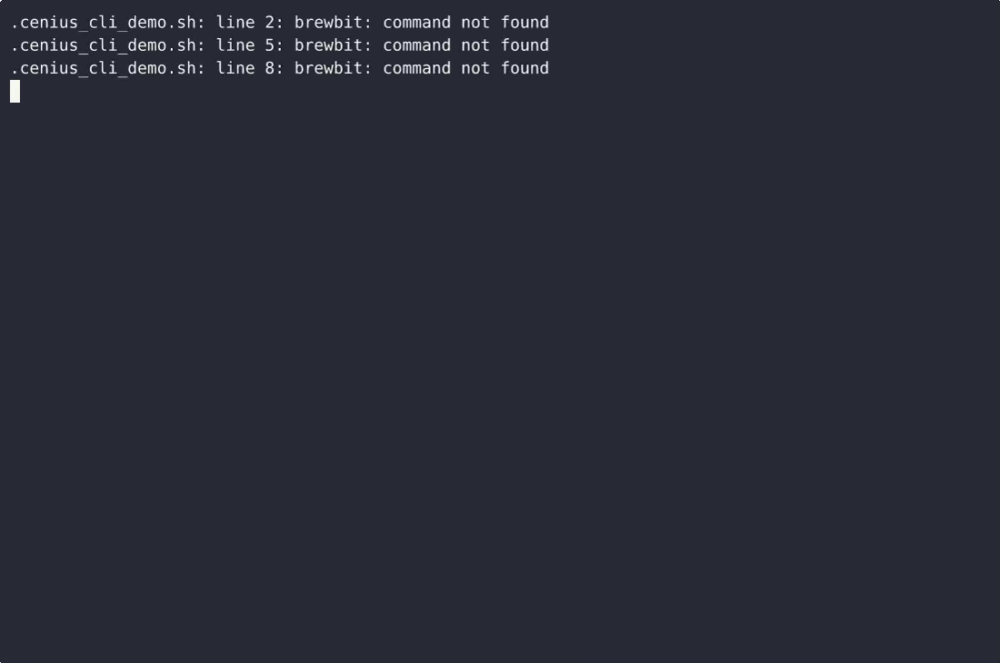
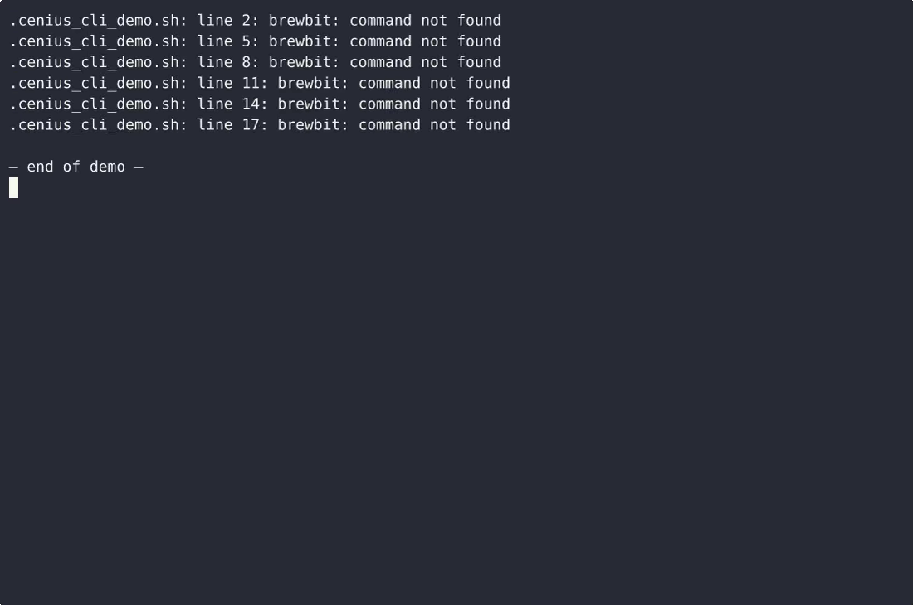

# BrewBit — complete Full-stack app command-line tool example app

**BrewBit** is a production-grade command-line tool written in Full-stack app — generated by cenius.ai, Apache-2.0-licensed. BrewBit is a single-file, standard-library-only Python CLI for tracking espresso shots: it records shot doses and yields in grams, logs tasting notes per bean lot, and flags green coffee as stale based on roast date. Clone BrewBit, run the installer, done — you have a working product in minutes. Want to change something? [Open BrewBit on cenius.ai](https://cenius.ai/marketplace/p/brewbit?ref=gh&utm_campaign=brewbit-webapp) and say what you need — a revised build ships back, ready to deploy.


[](LICENSE)  [](https://cenius.ai)

[](https://cenius.ai/marketplace/p/brewbit?ref=gh&utm_campaign=brewbit-webapp)

> **▶ [Open & edit in cenius.ai](https://cenius.ai/marketplace/p/brewbit?ref=gh&utm_campaign=brewbit-webapp)** — one click to an editable workspace: describe changes in plain English, get an instant preview, one-click deploy and host. Modifications made on the platform come with full rebrand & relicense rights.

_Local clone? See [Quick start](#quick-start) below. cenius.ai is the zero-setup path._

## Demo


📽 **[Watch the walkthrough](https://cenius.ai/marketplace/p/brewbit?ref=gh&utm_campaign=brewbit-webapp)** — plays on cenius.ai · [MP4 file](.github/media/demo.mp4)

## Screenshots

 

## Usage guide

Every walkthrough below is copy-pasteable and matches what the tool actually prints.
`brewbit` below means `python3 brewbit.py` (or the installed console script).

### 1. Register the beans you bought

```bash
brewbit lot add --name Kenya-AA-Nyeri --roast-date 2024-05-01
## lot added: Kenya-AA-Nyeri (roast date 2024-05-01)
```

The name is the handle every shot and note attaches to, so it must be unique and the
roast date must be a real ISO date:

```bash
brewbit lot add --name Kenya-AA-Nyeri --roast-date 2024-06-01
## error: lot 'Kenya-AA-Nyeri' already exists (choose another name)
## exit code 2, the original lot is untouched

brewbit lot add --name Brazil-Cerrado --roast-date 05/01/2024
## error: invalid roast date '05/01/2024' (expected YYYY-MM-DD, e.g. 2024-05-01)
## exit code 2, no lot is created
```

See what you have. The note count comes straight from the notes you logged:

```bash
brewbit lot list
## LOT             ROAST DATE  NOTES
## --------------  ----------  -----
## Brazil-Cerrado  2024-09-17  1
## Kenya-AA-Nyeri  2024-10-18  2
```

With no lots yet, the listing tells you the next command to run:

```
no lots yet: brewbit lot add
```

### 2. Log every shot

Dose and yield are grams and must be positive numbers:

```bash
brewbit shot add --lot Kenya-AA-Nyeri --dose 18 --yield 36 --grind "fine, 28s"
## shot recorded: Kenya-AA-Nyeri dose 18g yield 36g (fine, 28s)
```

`--grind` is optional free text for the grind setting or the shot time. When exactly one
lot exists you can drop `--lot`; with several lots BrewBit asks which one instead of
guessing.

_Full guide: [`USAGE.md`](USAGE.md)_

## Features

- Shot dosing log
- Bean lot tasting notes
- Stale green coffee flag

## Quick start

```bash
./install.sh   # installs dependencies + seeds demo data
```

See [`INSTALL.md`](INSTALL.md) for full setup and usage instructions.

## Architecture

Folder layout: `tests/`. The setup script (`install.sh`) installs runtime dependencies and loads a starter dataset so the app is immediately usable. Built in Full-stack app (23 files). For environment-specific setup, see [`INSTALL.md`](INSTALL.md).

## FAQ

### Can I deploy BrewBit on my own infrastructure?

`git clone` + `./install.sh` gets you a running instance — the install script provisions dependencies and demo data. Full steps live in [`INSTALL.md`](INSTALL.md); nothing external is needed to try it.

### Is there a no-code way to modify BrewBit?

[cenius.ai](https://cenius.ai/marketplace/p/brewbit?ref=gh&utm_campaign=brewbit-webapp) handles the implementation. Tell it what you want in everyday words, pick up the updated build. No coding needed.

### How is BrewBit built technically?

Full-stack app. The full source in this repository is exactly what the app runs. Highlights include stale green coffee flag.

### Is it OK to ship BrewBit as part of a product?

Confirmed free for commercial use — MIT terms let you incorporate, resell, or ship it in any product. [LICENSE](LICENSE).

### How do I make BrewBit my own brand?

Yes. The MIT license lets you remove the original branding and ship under your own name. For a guided approach, [remix it on cenius.ai](https://cenius.ai/marketplace/p/brewbit?ref=gh&utm_campaign=brewbit-webapp): you get a fresh build with full rebrand and relicense rights.

## License & rebranding

Released under the [Apache License 2.0](LICENSE) (© 2026 Cenius AI) — free for personal and commercial use. The Cenius name/logo are trademarks (see NOTICE).

**Need a customized version?** [Remix this app on cenius.ai](https://cenius.ai/marketplace/p/brewbit?ref=gh&utm_campaign=brewbit-webapp) — modifications made on the platform come with **full rebrand & relicense rights** over your derivative.

## Built with cenius.ai

This entire application — code, design, seeded demo data — was generated on **[cenius.ai](https://cenius.ai)** from a plain-English description.

- 🚀 [Build your own app on cenius.ai](https://cenius.ai)
- 🎛️ [Remix BrewBit on the marketplace](https://cenius.ai/marketplace/p/brewbit?ref=gh&utm_campaign=brewbit-webapp) — open it in a workspace, prompt for changes, and ship your own version.

More open-source apps: [the Cenius-ai catalog](https://github.com/Cenius-ai) · [showcase index](https://github.com/Cenius-ai/showcase)
